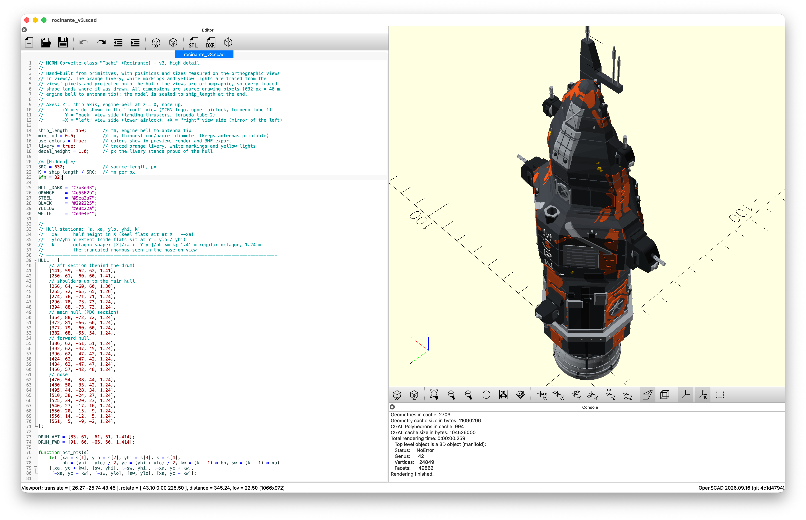

# Slopcinante 

This is an experiment, creating a 3D model of the Rocinante from The Expanse using OpenSCAD and partically non-existent CAD or OpenSCAD skills, vibeing with Claude using the Opus 5.5 model.

I googled "Rocinante side view" grabbed an image, fed it to the robot, and asked it to generate OpenSCAD code. This is the 3rd iteration but my contribution was roughly *"please add more detail"*. 

## Ethics & License

I am pretty sure the original image is copyrighted, hence I am not publishing it here. The legality of this scad code is questionable but I am not a lawyer and I am not publishing it for commercial purposes, it feels only fair to put it in the public domain. If you are the copyright holder of the original image and have an issue with this, please contact me and I will remove it.

Everything in this repo is licensed under the [CC0 1.0 Universal (CC0 1.0) Public Domain Dedication](https://creativecommons.org/publicdomain/zero/1.0/).
